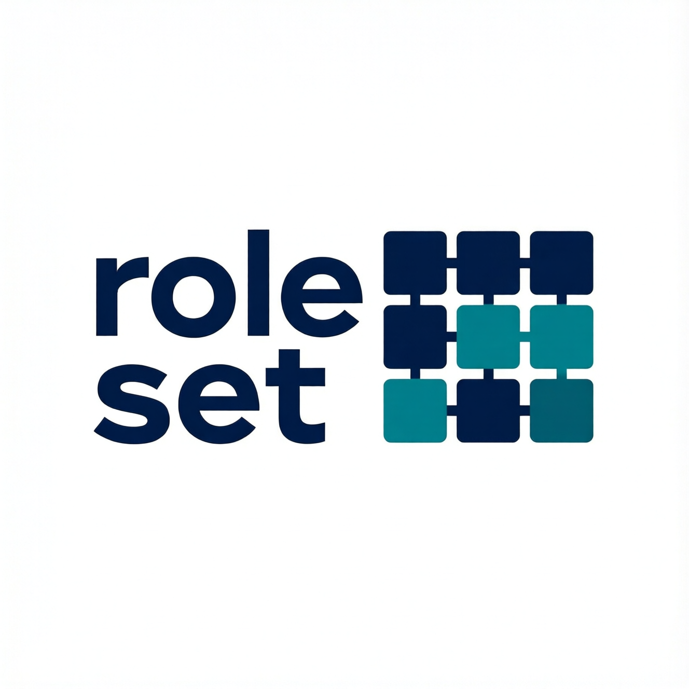

# role-set



**Prototype, developed in the open.** Advisory and experimental: interfaces and data shapes change without notice. A generator for role-shaping training data. It plans every item before a model
writes one, has a large model on a rented pod write only the parts a writer should write, and passes each
item through the same gates the humans use before a human sees it. It is a generator, not a judge: what a
good verifier is lives in the role pack, which humans write; every refusal is structural.

The design, agreed by the Publisher, ASPIRE and R&D, is in [docs/role-set-design.md](docs/role-set-design.md).
This repository is the scaffold of that design. What exists so far:

- `role-set plan`: fixes every slot for a batch (kind, side, verdict, pairs, two-turn items, escalate items,
  multi-line keys, puzzle structures, real-source slots) so the floors hold by construction, from a seed, with
  no model call. The plan refuses itself if a floor can't be met.
- `role-set cost`: pod hours and dollars for a plan, before anything is launched.
- `role-set write`: the runner. Refused until aspire-si's gates package is pinned here.
- The guards: only `http://127.0.0.1:<port>` endpoints, only licence-checked writers, never a cloud tag, and a
  5090 step only inside a Publisher grant with a fresh watchdog heartbeat.

## What it will not do

role-set never plans, launches, prices or shuts down a pod; the human does that with offrig, which holds the
budget. It never reads the sealed set, the DEV sets or the pre-interview. It never copies a gate: the gates are
imported from aspire-si at a pinned commit. Nothing leaves this machine but prompts to the loopback endpoint.

## Develop

Python 3.12, managed by uv. One runtime dependency: aspire-si-gates, pinned to an aspire-si commit, so the
gates are imported, never copied.

```
uv sync --frozen
uv run pytest
uv run role-set plan --lessons T02,T03 --seed 0 --out plan.json
uv run role-set cost --plan plan.json --profile two-card
```

The coverage floor is 90% and CI enforces it, with Codecov at 90% for the project and every change. The repo
stays private until that is in place.
